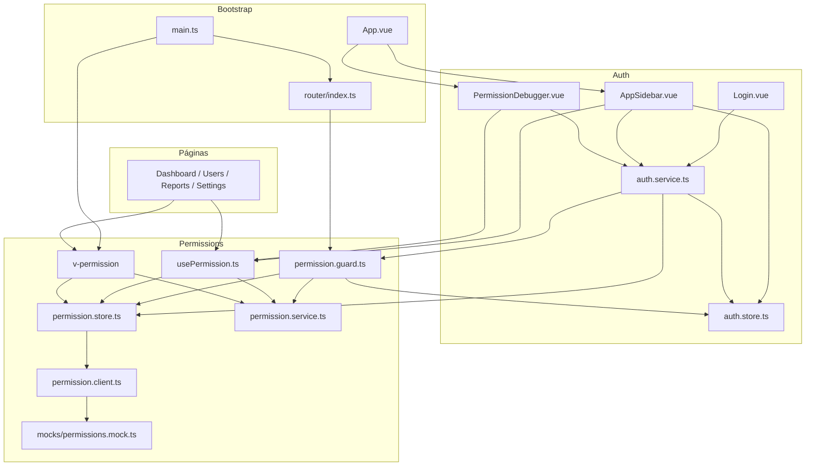
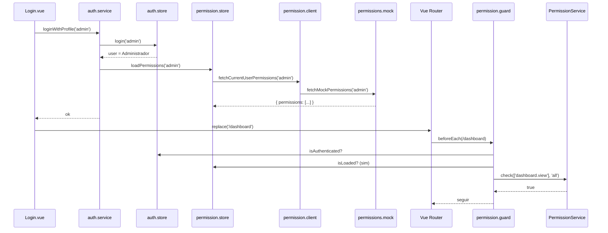

# Arquitetura da PoC — Permission-Based Access Control

Esta PoC demonstra um frontend Vue 3 + TypeScript com autorização baseada em permissões, desacoplada da autenticação e pronta para, no futuro, consumir `GET /api/me/permissions` de um backend Laravel.

Não há API real. Usuário, sessão e permissões são mockados. A regra de ouro:

> **Só o Permission Service decide se o usuário pode ou não.** Store guarda estado. Guard e UI apenas perguntam ao Service.

O backend Laravel continuará sendo a fonte definitiva de autorização (Gates, Policies, Middleware). O frontend só esconde rotas e botões.

---

## 1. O que o sistema está fazendo

A aplicação responde a três perguntas, em camadas diferentes:

| Pergunta | Quem responde | Onde vive |
| --- | --- | --- |
| Quem é o usuário? Ele está logado? | Auth Store | `src/modules/auth/` |
| Quais permissões ele tem agora? | Permission Store | `src/modules/permissions/stores/` |
| Com essa lista, ele pode fazer X? | Permission Service | `src/modules/permissions/services/` |

Exemplos de X: abrir `/users`, ver o botão **Excluir**, mostrar o item **Configurações** na sidebar.

Há dois tipos de proteção:

1. **Rota** — o Vue Router chama o Guard *antes* de entrar na página. Sem permissão, a página nem abre (vai para `/403`).
2. **UI** — hook e diretiva escondem botões e links. Isso é só UX. Uma requisição real no Laravel ainda precisa validar.

---

## 2. Mapa das pastas

```text
src/
├── main.ts                          # sobe Vue, Pinia, Router e a diretiva
├── App.vue                          # shell (sidebar + debugger) se autenticado
├── router/index.ts                  # rotas + meta.permissions + beforeEach
├── mocks/                           # dados falsos no formato do Laravel
│   ├── user.mock.ts
│   └── permissions.mock.ts
├── modules/
│   ├── auth/                        # autenticação (quem está logado)
│   │   ├── stores/auth.store.ts
│   │   └── services/auth.service.ts # orquestra login/logout/troca de perfil
│   └── permissions/                 # autorização (o que o logado pode)
│       ├── types/permission.types.ts
│       ├── api/permission.client.ts # único ponto a virar HTTP no futuro
│       ├── services/permission.service.ts
│       ├── stores/permission.store.ts
│       ├── guards/permission.guard.ts
│       ├── hooks/usePermission.ts
│       └── directives/permission.directive.ts
├── pages/                           # telas da PoC
└── components/
    ├── AppSidebar.vue
    └── PermissionDebugger.vue
```

Autenticação e autorização são módulos separados de propósito. O Auth Store não avalia permissão. O Permission Service não sabe quem é o usuário.

---

## 3. Quem chama quem

Este é o grafo de dependências. Setas significam **“usa / chama”**.



O **Service não chama ninguém**. Ele recebe uma lista de strings e devolve `true`/`false`. Guard, hook e diretiva instanciam o Service com a lista que está no Store.

O **Auth Service** é o único orquestrador: ele fala com os dois stores e, na troca de perfil, pede ao Guard para reavaliar a rota atual.

---

## 4. Peça a peça

### 4.1 Auth Store — `useAuthStore`

**Faz:** guarda o usuário mockado, o perfil atual (`admin` | `operator` | `viewer`) e se está autenticado.

**Não faz:** carregar permissões, avaliar `can()`, redirecionar.

| Estado / método | Função |
| --- | --- |
| `user` | `{ id, name, email, authenticated }` ou `null` |
| `currentProfile` | perfil escolhido no login |
| `isAuthenticated` | `user.authenticated === true` |
| `login(profile)` | copia o usuário mock daquele perfil |
| `logout()` | zera usuário e perfil |

Chamado por: `auth.service.ts` e, para *exibir* nome/perfil, `AppSidebar` e `Dashboard`.

### 4.2 Auth Service — `loginWithProfile` / `logout` / `switchProfile`

**Faz:** coordenar autenticação + permissões para a UI não ter que falar com dois stores.

```text
loginWithProfile(profile)
  → authStore.login(profile)
  → permissionStore.loadPermissions(profile)

logout()
  → authStore.logout()
  → permissionStore.clearPermissions()

switchProfile(profile, router)
  → loginWithProfile(profile)
  → evaluateRouteAccess(rota atual)
  → se negado, router.replace(/403 ou /login)
```

Quem chama:

- `Login.vue` → `loginWithProfile`
- `AppSidebar.vue` → `logout`
- `PermissionDebugger.vue` → `switchProfile`

### 4.3 Permission Client — `fetchCurrentUserPermissions`

**Faz:** uma função com o contrato do Laravel:

```json
{ "permissions": ["users.view", "users.create"] }
```

Hoje ela só delega para `src/mocks/permissions.mock.ts` (com delay de 120 ms para simular rede).

**É o único arquivo que deve virar HTTP.** Service, Guard, hook e diretiva não mudam.

Quem chama: só o Permission Store.

### 4.4 Permission Store — `usePermissionStore`

**Faz:** estado global das permissões.

| Estado / método | Função |
| --- | --- |
| `permissions` | lista atual (`string[]`) |
| `isLoading` / `isLoaded` / `error` | ciclo de carga |
| `loadPermissions(profile)` | busca no client e grava a lista |
| `updatePermissions(list)` | troca a lista sem fetch (útil em testes) |
| `clearPermissions()` | volta ao vazio (logout) |

**Não faz:** `can()`, `canAny()`, `canAll()`. Componentes não devem “inventar” regra olhando o array; só o Debugger/Dashboard *listam* o array para inspeção.

Quem chama: Auth Service, Guard, hook, diretiva.

### 4.5 Permission Service — `PermissionService`

**Faz:** a matemática da autorização. Classe pura, sem Vue, sem Pinia, sem HTTP.

```ts
createPermissionService(['users.view', 'users.create'])
service.can('users.view')                         // true
service.canAny(['users.delete', 'users.create'])  // true
service.canAll(['users.view', 'users.delete'])    // false
service.check(['users.view'], 'all')              // true
```

Regras de lista vazia (explícitas e estáveis):

| Chamada | Resultado | Por quê |
| --- | --- | --- |
| `canAny([])` | `false` | não existe candidato para satisfazer |
| `canAll([])` | `true` | não existe requisito para cumprir |
| `check([], 'any')` | `false` | igual a `canAny` |
| `check([], 'all')` | `true` | igual a `canAll` (default do `check`) |

Quem chama: Guard, `usePermission`, `v-permission`. Nunca as páginas diretamente.

### 4.6 Route Guard — `permissionGuard` / `evaluateRouteAccess`

**Faz:** decidir se a navegação segue, vai para login ou vai para 403.

Registrado em `router/index.ts`:

```ts
router.beforeEach(permissionGuard)
```

Algoritmo:

1. Se a rota **não** exige auth (`requiresAuth !== true`):
   - se for `/login` e o usuário já está autenticado → dashboard (evita loop)
   - senão → deixa passar (`/login`, `/403`)
2. Se exige auth e **não** está autenticado → `/login?redirect=...`
3. Se as permissões ainda não foram carregadas → `permissionStore.loadPermissions`
4. Lê `meta.permissions` e `meta.permissionMode`
5. Cria um `PermissionService` com a lista do store e chama `check`
6. Sem permissão → `/403`

Quem chama:

- Vue Router, em **toda** navegação
- Auth Service, na **troca de perfil**, porque o Router não reexecuta o `beforeEach` sozinho quando só o store muda

### 4.7 Hook — `usePermission`

**Faz:** ponte reativa entre Store e Service para o `<script setup>`.

```ts
const { can, canAny, canAll, check } = usePermission()

can('users.delete')
```

Por dentro: observa `permissionStore.permissions` com `computed` e recria o Service quando a lista muda. Por isso a sidebar some/aparece na hora ao trocar o perfil.

Quem chama: `AppSidebar`, `Users.vue` (texto “Somente leitura”), `PermissionDebugger`.

### 4.8 Diretiva — `v-permission`

**Faz:** a mesma avaliação no template, sem o componente implementar regra.

```vue
<button v-permission="'users.create'">Criar usuário</button>

<button
  v-permission="{ permissions: ['users.create', 'users.update'], mode: 'any' }"
>
  Gerenciar usuários
</button>
```

Registrada em `main.ts` como `app.directive('permission', ...)`.

Comportamento:

- no `mounted`, observa o array do store
- se autorizado, restaura o `display` original
- se não, `display: none` (o elemento **permanece no DOM** para poder reaparecer)
- no `updated`, reavalia se o binding do template mudou

Quem usa: `Users.vue`, `Reports.vue`, `Settings.vue`.

---

## 5. Fluxos em tempo de execução

### 5.1 Subida da aplicação

```text
main.ts
  → createPinia()
  → createRouter()          // já tem router.beforeEach(permissionGuard)
  → app.directive('permission')
  → mount(App)
```

O usuário cai em `/` → redirect `/dashboard` → Guard vê que não está autenticado → `/login?redirect=/dashboard`.

### 5.2 Login



### 5.3 Clique num link da sidebar

A sidebar **já filtrou** o link com `usePermission().can('settings.view')`. Mesmo assim o Guard roda de novo ao navegar: a UI não é a defesa real.

```text
AppSidebar (can('settings.view') === true)
  → RouterLink /settings
  → permissionGuard
  → PermissionService.check(['settings.view'], 'all')
  → Settings.vue monta
  → botão "Editar" usa v-permission="'settings.update'"
```

Se o operador colar `/settings` na URL, o link não está na sidebar, mas o Guard ainda manda para `/403`.

### 5.4 Troca de perfil no Debugger

Não recarrega a página. Atualiza stores e reavalia a rota atual.

```text
PermissionDebugger clica em "Visualizador"
  → switchProfile('viewer', router)
  → authStore.login('viewer')           // nome/e-mail mudam
  → permissionStore.loadPermissions     // lista nova
  → hook e v-permission reagem    // botões/links mudam
  → evaluateRouteAccess(rota atual)
       se estava em /users e viewer não tem users.view
       → router.replace('/403')
```

### 5.5 Logout

```text
AppSidebar → logout()
  → authStore.logout()
  → permissionStore.clearPermissions()
  → router.replace('/login')
```

O Guard, nas próximas navegações, vê `isAuthenticated === false` e bloqueia rotas protegidas.

---

## 6. Rotas e permissões

Definidas em `src/router/index.ts` via `meta`:

| Rota | Auth | Permissão | Quem acessa no mock |
| --- | --- | --- | --- |
| `/login` | pública | — | todos |
| `/403` | pública | — | todos (inclusive logados) |
| `/dashboard` | sim | `dashboard.view` | admin, operador, visualizador |
| `/users` | sim | `users.view` | admin, operador |
| `/users/delete-example` | sim | `users.delete` | só admin |
| `/reports` | sim | `reports.view` | admin, operador, visualizador |
| `/settings` | sim | `settings.view` | só admin |

Ações *dentro* da página (não são rota):

| Ação | Permissão | Onde |
| --- | --- | --- |
| Criar usuário | `users.create` | `v-permission` em `Users.vue` |
| Editar usuário | `users.update` | `v-permission` em `Users.vue` |
| Excluir usuário | `users.delete` | `v-permission` em `Users.vue` |
| Exportar relatório | `reports.export` | `v-permission` em `Reports.vue` |
| Editar configurações | `settings.update` | `v-permission` em `Settings.vue` |

---

## 7. Perfis mockados

| Perfil | Permissões |
| --- | --- |
| Administrador | `dashboard.view`, `users.view/create/update/delete`, `reports.view/export`, `settings.view/update` |
| Operador | `dashboard.view`, `users.view`, `users.create`, `reports.view` |
| Visualizador | `dashboard.view`, `reports.view` |

Os usuários correspondentes estão em `src/mocks/user.mock.ts`. O Permission Store não lê esse arquivo; quem escolhe o perfil é o Auth Store / Auth Service.

---

## 8. O que cada camada **não** pode fazer

Isso é o que mantém o desenho testável e fácil de plugar no Laravel:

| Camada | Proibido |
| --- | --- |
| Permission Service | importar Vue, Pinia, Router, mocks, HTTP |
| Permission Store | implementar `can` / `canAny` / `canAll` |
| Páginas | ler `permissionStore.permissions` para decidir botão (exceto listar no Dashboard/Debugger) |
| Guard | copiar a lógica do Service; ele só chama `check` |
| Hook / diretiva | buscar API; só leem o Store e perguntam ao Service |
| `localStorage` | ser fonte de verdade das permissões |

---

## 9. Integração futura com Laravel

Contrato esperado:

```http
GET /api/me/permissions
```

```json
{
  "permissions": ["users.view", "users.create", "reports.view"]
}
```

Troca prevista:

1. Implementar o HTTP em `src/modules/permissions/api/permission.client.ts`
2. O login real passará a preencher o Auth Store com o usuário da sessão Laravel
3. O parâmetro `profile` some — existia só para a PoC alternar personas
4. Service, Guard, `usePermission` e `v-permission` permanecem iguais

O frontend continua sendo uma *projeção* das permissões. Qualquer `POST /users` no Laravel ainda precisa de Policy/Gate.

---

## 10. Como validar a PoC

```sh
npm install --legacy-peer-deps
npm run dev          # http://localhost:5173
npm run test:unit    # Vitest: Service, Store, Guard, hook, diretiva
```

Caminho manual sugerido:

1. Abrir a app deslogado → cai em `/login`.
2. Entrar como **Administrador** → sidebar completa, botões de criar/editar/excluir visíveis.
3. Ir em Usuários e clicar **Excluir usuários** → rota `/users/delete-example` abre.
4. No Debugger, trocar para **Operador** → some Configurações, Editar e Excluir; **Criar** permanece.
5. Trocar para **Visualizador** estando em `/users` → redirect para `/403`.
6. Relatórios como visualizador → sem botão Exportar.
7. Sair → volta ao login; colar `/dashboard` na URL redireciona de novo para login.
